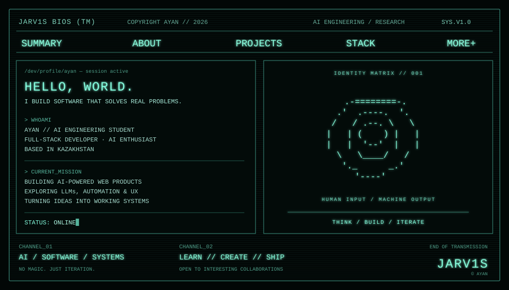

  
   
  

    
    
    
  

  Building useful products where software, AI, and thoughtful design meet.
    
  <a href="#about">ABOUT</a> ·
  <a href="#selected-builds">BUILDS</a> ·
  <a href="#toolkit">TOOLKIT</a> ·
  <a href="#contribution-signal">CONTRIBUTION SIGNAL</a> ·
  <a href="#connect">CONNECT</a>

---

## 01 / About

I’m **Ayan**, an AI engineering student and full-stack developer from Kazakhstan. I like taking an early idea, shaping the experience, and turning it into a working product.

- **Building:** web applications and practical AI-powered tools
- **Exploring:** LLMs, automation, product interfaces, and software architecture
- **Working style:** learn fast, make useful things, improve them in the open

## 02 / Selected builds

| PROJECT | WHAT IT IS | STATUS |
|:--|:--|:--:|
| [Qaragull](https://github.com/Jarv1s-stack/qaragull) | A web project focused on presenting information through a clear interface. | <code>BUILDING</code> |
| [EloWork.kz](https://github.com/Jarv1s-stack/EloWorkkz) | A freelance platform concept with reputation-based profiles and AI task-complexity assessment. | <code>BUILDING</code> |
| [Ayan.dev](https://jarv1s-stack.github.io/Ayan.dev/) | My portfolio and digital workspace. | <code>ONLINE</code> |

## 03 / Toolkit

  
  
  
  
  
  
  
  
  

## 04 / Current objectives

- [x] Build and publish web projects
- [x] Explore practical AI integrations
- [ ] Deepen software engineering fundamentals
- [ ] Build reliable AI products from idea to deployment

## 05 / Contribution signal

A little arcade energy for the contribution graph. This animated snake is generated from my GitHub activity and refreshes daily through [GitHub Actions](https://github.com/Jarv1s-stack/Jarv1s-stack/actions/workflows/profile-snake.yml).

<picture>
  <source media="(prefers-color-scheme: dark)" srcset="https://raw.githubusercontent.com/Jarv1s-stack/Jarv1s-stack/output/github-snake-dark.svg" />
  <source media="(prefers-color-scheme: light)" srcset="https://raw.githubusercontent.com/Jarv1s-stack/Jarv1s-stack/output/github-snake.svg" />
  
</picture>

## 06 / Connect

   
  <strong>THINK → BUILD → ITERATE</strong> Stay curious. Keep shipping.

